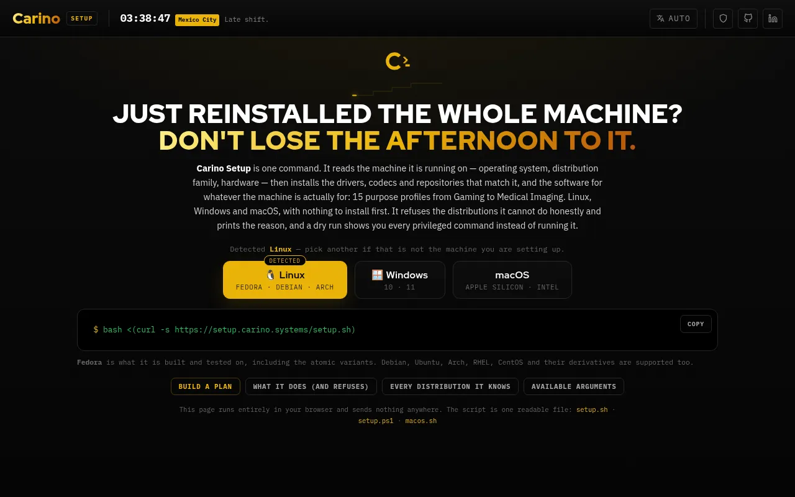

# Carino Setup

Setup scripts **for Linux, Windows and macOS**, so the user does not have to worry about choices besides their actual use case.

Site: <https://setup.carino.systems>



> The GitHub repository is still literally named `SimpleSetup`. Only the owner can rename it, so every `https://github.com/MiguelCarino/SimpleSetup` link is left exactly as it is and keeps working. Renaming the repository is a pending owner action; nothing in this repository depends on it.

## One-liners

```bash
bash <(curl -s https://setup.carino.systems/setup.sh)      # Linux
```

```powershell
iwr -useb https://setup.carino.systems/setup.ps1 | iex     # Windows 10 and 11, elevated PowerShell
```

```bash
bash <(curl -s https://setup.carino.systems/macos.sh)      # macOS, Homebrew, Apple Silicon
```

Most of this page is about `setup.sh`: one plain bash file in 14 numbered sections (0–13). All the package names are kept together in section 4 as arrays named `<group>_<family>`. `setup.ps1` (Windows) and `macos.sh` (macOS) are separate, shorter files laid out the same way: a system table first, the same 15 purposes, a plan, a dry run, a log and a summary. They have their own sections: [Windows](#windows-setupps1) and [macOS](#macos-macossh).

## What it does, in order

Run it as your normal user. It runs each command that changes the system through `sudo`, `doas` or `run0`, prints the command first, and puts user files in the home of the real user (`SUDO_USER` when started with sudo).

1. **Check the system.** It reads `/etc/os-release` and finds the family from `ID`, then from `ID_LIKE`. It then prints a table: distribution, family, package manager, kernel, architecture, CPU, every GPU (with the NVIDIA generation), laptop, virtual machine, Secure Boot, atomic, desktop session, free disk, internet, and which user the files are for. It refuses NixOS and Guix System (and prints a `configuration.nix` or `config.scm` snippet instead), SteamOS, transactional openSUSE (MicroOS, Aeon, Kalpa), any distribution it does not recognise (it prints the `ID`, `ID_LIKE` and name it read, and where to report it), a kernel that is not Linux (see [BSD and macOS](#bsd-and-macos)), and a machine with no root and no `sudo`/`doas`/`run0`. When it refuses, nothing has run.
2. **Base setup and drivers** (asks, default yes):
   - adds the repositories that codecs and drivers need
   - upgrades the whole system
   - installs the base packages, codecs, firmware and CPU microcode (no firmware or microcode in a VM)
   - installs Flatpak and adds Flathub
   - installs the GPU drivers:
     - **NVIDIA** asks first. Turing and newer get the open module, Maxwell and Pascal the 580 branch, and Kepler the 470 branch where the family packages it. With Secure Boot on, it prints the MOK enrolment steps first.
     - **AMD and Intel** get Mesa, Vulkan and VA-API.
     - **In a VM**, it installs guest tools instead.
3. **Desktop.** The menu appears only when no desktop session or display manager is found. It lists the 12 desktops, `none` and Carino Hyprland, and the default is `none`.
4. **Purpose profiles.** It lists the 15 purposes and accepts several numbers (`2 6`). Each profile installs the basic applications, its own native list where the family has one, and its Flatpaks.
5. **Carino Hyprland.** It asks *"Install the Carino Hyprland desktop configuration?"* (default no). It asks only where Hyprland 0.55 or newer can be installed. Everywhere else it prints one line saying why not.
6. **Summary.** It shows what was done, skipped or failed, then asks whether to reboot (default no).

A failed package never stops the run. Names the package manager cannot find are listed and skipped. If a batch fails, each package is retried on its own. dnf skips unknown names itself and can exit with success when it installed none of them, so after each dnf install the script asks `rpm` which names are really there: none is recorded as a skip (`none available`), some as `ok (N of M)` with the missing names listed. Groups (`@...`) are taken on dnf's word.

## Supported distributions

| Family | Examples | Base | Drivers | Profiles (native lists) | Carino Hyprland |
| --- | --- | --- | --- | --- | --- |
| Fedora | Fedora, Nobara, Ultramarine, Risi | RPM Fusion, OpenH264, full ffmpeg | NVIDIA open / 580xx / 470xx (akmods), AMD, Intel | all | yes, COPR `lionheartp/Hyprland` |
| Fedora Atomic | Silverblue, Kinoite, Bazzite, Bluefin, Aurora | a few tools, layered with `rpm-ostree` (reboot) | NVIDIA layered (Universal Blue images: rebase to `-nvidia`); Mesa comes with the image | Flatpaks only | no |
| Enterprise Linux | RHEL, AlmaLinux, Rocky, CentOS Stream, Oracle, Amazon | CRB, EPEL, RPM Fusion free (Oracle: its own EPEL and CodeReady repositories; Amazon: none) | NVIDIA Turing+ (AlmaLinux repository; others get instructions), AMD, Intel | Fedora lists, missing names skipped | no |
| Debian | Debian, LMDE, MX, Kali, Parrot, Devuan, Raspberry Pi OS | contrib + non-free | NVIDIA open / 580, AMD, Intel | all | Debian 13 (backports), forky, sid, and derivatives that name one of them in `DEBIAN_CODENAME` (LMDE 7) |
| Ubuntu | Ubuntu, Mint, Pop!_OS, elementary, Zorin, KDE neon, TUXEDO | universe, multiverse, restricted | `ubuntu-drivers` (Pop!_OS: `system76-driver-nvidia`), AMD, Intel | Debian lists | 24.04 and 26.04 bases, derivatives included (PPA `cppiber/hyprland`); Ubuntu 26.10+ itself |
| Arch | Arch, Manjaro, EndeavourOS, CachyOS, Garuda | asks to enable `[multilib]` | NVIDIA Turing+ (older: AUR, says so), AMD, Intel | all | yes |
| openSUSE | Tumbleweed, Slowroll, Leap, SLES | asks to add Packman (openSUSE only, not SLES) | NVIDIA G07 / G06 from NVIDIA's repository (openSUSE only), AMD, Intel | basic, gaming, corporate, development | Tumbleweed, Slowroll |
| Solus | Solus | short base list | NVIDIA (current driver) | Flatpaks only | yes |
| Alpine | Alpine, postmarketOS | community repository | AMD, Intel (no NVIDIA on musl) | basic, development | no (ships 0.54) |
| Void | Void, glibc and musl | nonfree (+ multilib) | NVIDIA Turing+ on glibc, AMD, Intel | basic | no |
| Gentoo | Gentoo, Funtoo | base packages only | printed steps (USE flags) | Flatpaks only | no (steps printed) |
| Slackware | Slackware 15.0 and -current | base packages, codecs and firmware with `slackpkg` (pick a mirror in `/etc/slackpkg/mirrors` first) | printed steps (SlackBuilds.org) | none (one line: SlackBuilds.org) | no |
| Mageia | Mageia, OpenMandriva | nonfree + tainted on Mageia (OpenMandriva: enable non-free in `om-repo-picker`) | NVIDIA via the Control Center | Flatpaks only | no |
| *refused* | NixOS, Guix System, SteamOS, MicroOS / Aeon / Kalpa, anything unknown, FreeBSD / OpenBSD / NetBSD / DragonFly, macOS (use `macos.sh`) | — | — | — | — |

"All" means every purpose that has a list of its own: 13 of the 15. Corporate (Microsoft only) and Corporate (Google only) install the basic applications plus Flatpaks on every family. The desktops have package lists on Fedora, Arch and openSUSE (all 12), Debian and Ubuntu (all but Niri), EL (GNOME, XFCE, KDE, LXQt, Cinnamon, MATE) and Solus (Hyprland); Mageia has none. The [plan builder](https://setup.carino.systems) shows the exact packages for each family and profile.

### BSD and macOS

`setup.sh` is for Linux only. It checks `uname -s` before anything else, and on FreeBSD, OpenBSD, NetBSD or DragonFly it stops with one paragraph saying so and naming the system's own tool (`pkg`, `pkg_add`, `pkgin`). On macOS it points to `macos.sh`. Note that the BSDs do not install bash by default, so `bash <(curl ...)` fails there with "bash: not found" before the script can say anything; with bash installed you get the message above.

## Arguments

```bash
bash <(curl -s https://setup.carino.systems/setup.sh) <argument>
./setup.sh <argument>
```

| Argument | What it does |
| --- | --- |
| *(none)* | Interactive: the six steps above |
| `quick` | Base setup, then the Basic profile's native apps and the basic and Google Flatpaks |
| `simple` | Base setup only (repositories, upgrade, base packages, codecs, firmware, drivers) |
| `server` | Base, server and development packages, then enables SSH and Cockpit and opens them in firewalld |
| `drivers`, `nvidia`, `amd`, `intel` | GPU drivers only, after the repositories they need. All four are the same, because the GPU is detected |
| `desktop` | The desktop menu, even when a desktop is already running |
| `hyprland` | Carino Hyprland only |
| `distrobox` | Fedora, Ubuntu and Debian distrobox containers |
| `anydesk` | AnyDesk and RustDesk Flatpaks |
| `librewolf` | LibreWolf: repository on Fedora/EL/Debian/Ubuntu, Flatpak elsewhere |
| `share` | Asks first, then mounts a Windows (SMB) shared folder at `~/WinFiles` |
| `proton` | The latest GE-Proton into Steam's `compatibilitytools.d` (Flatpak Steam too) |
| `update` | Refreshes and upgrades packages and Flatpaks |
| `help` | Prints the usage text |

Any other argument, or more than one argument after `dry-run`, prints the usage text and exits with status 2.

### Unattended: `CARINO_SETUP_PLAN`

```bash
CARINO_SETUP_PLAN=technical,desktop=carino-hyprland,purpose=gaming,purpose=development bash <(curl -s https://setup.carino.systems/setup.sh)
```

The tokens are comma-separated and run left to right:

| Token | What it does |
| --- | --- |
| `technical` | Base setup (including drivers), then the desktop menu, which takes `none` |
| `drivers`, `update`, `server` | Same as the arguments |
| `desktop=<name>` | `gnome` `xfce` `kde` `lxqt` `cinnamon` `mate` `i3` `openbox` `budgie` `sway` `hyprland` `niri` `carino-hyprland` `none` |
| `hyprland` | Same as `desktop=carino-hyprland`. (`desktop=hyprland` installs plain Hyprland, without the Carino configuration.) |
| `purpose=<name>` | `basic` `gaming` `corporate` `corporate-microsoft` `corporate-google` `development` `astronomy` `compneuro` `design` `music` `cybersecurity` `forensics` `scientific` `robotics` `imagenology` (may repeat) |
| `reboot=yes` / `reboot=no` | Reboot at the end or not. Without it, the final prompt takes its default, no |

All tokens are checked before anything runs. If one token is unknown, the plan has no action (only `reboot=`), or a plan is combined with an argument, the whole run is refused with status 2. Under a plan, or when stdin is not a terminal, every question takes its default and says so:

| Question | Default |
| --- | --- |
| Base setup / NVIDIA driver / `[multilib]` / Packman | yes |
| Desktop menu (interactive flow, or after `technical`) | 13 (`none`) |
| Purpose profiles (interactive flow without a terminal) | 1 (Basic) |
| Distrobox containers after Development, SSH + Cockpit after `server` | yes |
| Carino Hyprland, Windows share, reboot | no |

## Dry run

```bash
./setup.sh dry-run                 # or --dry-run, or CARINO_SETUP_DRYRUN=1
./setup.sh dry-run quick
CARINO_SETUP_PLAN=technical,purpose=gaming ./setup.sh dry-run
```

Every command that changes the system goes through one function, `run`. In a dry run, `run` prints the command as `(dry-run) $ ...` and does not run it. File writes are printed with their content. Detection still runs for real (`lspci`, `/sys`, `df`, and `curl -sI https://flathub.org`), so the plan matches this machine. To make no network request, set `CARINO_SETUP_NET=0`.

## Logs

Each run writes `carino-setup-YYYYmmdd-HHMMSS.log` in the current directory, with colours stripped. If that directory is not writable, the log goes to `/tmp`. `CARINO_SETUP_LOG=<file>` picks the path. A dry run writes no log unless `CARINO_SETUP_LOG` is set.

| Variable | Effect |
| --- | --- |
| `CARINO_SETUP_PLAN` | The unattended plan above |
| `CARINO_SETUP_DRYRUN=1` | Same as `dry-run` |
| `CARINO_SETUP_LOG=<file>` | Log path |
| `CARINO_SETUP_OSRELEASE=<file>` | Read this instead of `/etc/os-release`, to see what another distribution would get |
| `CARINO_SETUP_ATOMIC`, `_GPU`, `_NVGEN`, `_VIRT`, `_NET`, `_UNAME` | Test hooks: force atomic, the GPU list (`"nvidia amd intel"`), the NVIDIA branch (`open`, `580`, `470`) or the VM type; `_NET=0` skips the internet check; `_UNAME` pretends to be another kernel (`FreeBSD`, `Darwin`, ...) |

## Carino Hyprland

Carino Hyprland is a complete Hyprland desktop: an ALT-based keymap, a waybar bar, a lock screen, idle handling, notifications, a launcher, clipboard history, screenshots, fonts and a wallpaper. It needs Hyprland **0.55 or newer**, because the configuration is `hyprland.lua`. Use the `hyprland` argument, the `desktop=carino-hyprland` (or `hyprland`) plan token, the desktop menu, or answer yes at the end of the interactive run. Steps:

1. Adds the Hyprland source where one is needed (COPR on Fedora, `trixie-backports` on Debian 13, the PPA on Ubuntu 24.04/26.04 bases).
2. Installs the `hypr_<family>` packages, then checks that `Hyprland --version` is at least 0.55.
3. Finds the bundle: [`hyprland/`](hyprland/) next to the script, or downloaded from this repository.
4. Moves any existing `~/.config` folder that the bundle also ships (`hypr`, `waybar`, `wofi`, `mako`, `kitty`, `cliphist`, `themes`) to `~/.config/carino-backup-<timestamp>/`.
5. Copies the bundle into your home folder, creates `~/Pictures/Screenshots`, runs `fc-cache -f` and prints the main keys.

Then log out and choose Hyprland at the login screen. The script does not install a login manager for it: with none, type `Hyprland` on a text console after logging in. To undo, move the folders back from the backup folder. Keys, contents and requirements are in [hyprland/README.md](hyprland/README.md).

## Windows: `setup.ps1`

For Windows 10 and 11, in an elevated PowerShell (Windows PowerShell 5.1 or PowerShell 7). Everything is installed with winget.

```powershell
iwr -useb https://setup.carino.systems/setup.ps1 | iex                       # interactive
powershell -ExecutionPolicy Bypass -File .\setup.ps1                         # from a checkout
$env:CARINO_SETUP_DRYRUN='1'; iwr -useb https://setup.carino.systems/setup.ps1 | iex
$env:CARINO_SETUP_PLAN='technical,tweaks,purpose=gaming,update,reboot=no'; iwr -useb https://setup.carino.systems/setup.ps1 | iex
```

`$env:` variables stay set for the rest of that PowerShell window, so a real run after a dry run in the same window is still a dry run. Clear them with `Remove-Item Env:CARINO_SETUP_DRYRUN, Env:CARINO_SETUP_PLAN` or open a new window. Under `iwr | iex` the script never calls `exit`, so it does not close your window.

What it does, in order:

1. **Check the system.** It prints a table: edition and release (such as 24H2), version and build, architecture, CPU, GPUs, laptop, virtual machine, Secure Boot, TPM, BitLocker on `C:`, free disk, winget version, internet and administrator. It refuses builds older than Windows 10 (10240), a shell that is not elevated, and a machine without winget (it links App Installer). If you elevated with a different account than the one at the desktop, it asks before going on (default no), because the per-user tweaks would land in the wrong account. On Windows Server it warns that some desktop apps will not install.
2. **Base setup** (asks, default yes): `winget source update`, the base apps (7-Zip, Firefox, SumatraPDF, K-Lite Basic, .NET desktop runtimes, Temurin 21 JRE, Git, Notepad++, PowerShell 7, Sysinternals, MediaInfo), the Visual C++ runtimes for the CPU architecture, then the **drivers**:
   - **NVIDIA** and **AMD** are not in winget, so it prints the vendor's download link and records a skip. Windows Update installs a WHQL driver meanwhile.
   - **Intel** asks to install Driver & Support Assistant (default yes).
   - **In a VM**: VirtIO guest tools on QEMU/KVM (asks, default yes), and a one-line note for Hyper-V, VMware and VirtualBox.
3. **Tweaks** (asks, default yes): dark apps, file extensions shown, no taskbar search box; on Windows 11 also no Task View, Widgets or Chat buttons, and on Windows 10 no News and interests and no "- Shortcut" suffix. Values that are already set are left alone, and Explorer restarts only when one changed. On 24H2 Windows protects the Widgets value; the script warns and goes on.
4. **Purpose profiles.** The same 15 purposes as `setup.sh`, several numbers allowed (`2 6`, `0` = none, default 1). Each installs its own list plus shared groups (basic, Google, Microsoft, support tools, remote desktop). Development also offers WSL with Ubuntu (default no). Cybersecurity warns that Nmap and Wireshark may need Npcap installed by hand. Corporate (Microsoft only) installs Microsoft 365, which needs a licence.
5. **Windows Update** (asks, default yes): `winget upgrade --all`, then the PSWindowsUpdate module installs every update with `-IgnoreReboot`. The module is a script module, so the execution policy is set to Bypass for that PowerShell process only (nothing is saved).
6. **Summary** of ok/skip/fail, then *"Restart now?"* (default no).

A failed winget id never stops the run. winget's "already installed" and "no newer version" codes count as success, and the "installed, finishes after a restart" codes mark the restart as needed.

| Plan token | What it does |
| --- | --- |
| `technical` | Base setup, including the drivers |
| `drivers` | The drivers step alone |
| `tweaks` | The Explorer tweaks |
| `update` | winget upgrade and Windows Update |
| `wsl` | WSL with Ubuntu (needs a restart) |
| `purpose=<name>` | Same names as `setup.sh` (may repeat) |
| `reboot=yes` / `reboot=no` | Restart at the end or not; without it the final prompt takes its default, no |

The tokens are comma-separated and run left to right. An unknown token, a bad `reboot=` value or a plan with nothing to do refuses the whole plan with status 2 before anything runs. Under a plan, or when input is redirected, every question takes its default and says so.

| Variable | Effect |
| --- | --- |
| `CARINO_SETUP_PLAN` | The plan above |
| `CARINO_SETUP_DRYRUN=1` | Prints every system-changing command as `(dry-run) >` and runs none. A dry run does not refuse a shell that is not elevated or has no winget; it warns |
| `CARINO_SETUP_LOG=<file>` | Transcript path. Default `carino-setup-YYYYmmdd-HHmmss.log` in the current folder, or in your user folder when that is under `C:\Windows` (where an elevated shell starts) or not a folder; none on a dry run unless set |
| `CARINO_SETUP_FAKE=1` | Test hook: skips the Windows queries and always forces a dry run. `CARINO_SETUP_BUILD`, `_GPU`, `_VIRT`, `_ARCH` shape the fake machine |

## macOS: `macos.sh`

For macOS 15 or newer (the oldest Homebrew supports) on Apple Silicon. Homebrew's installer no longer runs on Intel Macs, so an Intel Mac without Homebrew is refused; one that already has it gets a warning that every formula builds from source. Run it as your normal user, not with `sudo`: Homebrew refuses root. It is written for the stock `/bin/bash` 3.2.

```bash
bash <(curl -s https://setup.carino.systems/macos.sh)                  # interactive
bash <(curl -s https://setup.carino.systems/macos.sh) dry-run          # or --dry-run, or CARINO_SETUP_DRYRUN=1
CARINO_SETUP_PLAN=technical,tweaks,purpose=design,reboot=no bash <(curl -s https://setup.carino.systems/macos.sh)
```

What it does, in order:

1. **Check the Mac.** It prints a table: macOS version and build, architecture, CPU, model, GPU, laptop, virtual machine, FileVault, SIP, free disk, internet, Xcode Command Line Tools and Homebrew. It refuses anything that is not macOS, running as root, macOS older than 15, a shell running under Rosetta, and an Intel Mac without Homebrew.
2. **Base setup** (asks, default yes): the Command Line Tools if missing (with Homebrew already there this opens Apple's dialog and waits for Return; under a plan it records a skip), Homebrew (unattended under a plan or without a terminal), Homebrew on `PATH` with an offer to add it to the login shell's profile (`${ZDOTDIR:-~}/.zprofile` for zsh, `~/.bash_profile` for bash; default yes, not asked when the installer wrote `/etc/paths.d/homebrew`), `brew update`, the base tools (git, wget, jq, rsync, htop, fastfetch, 7-Zip, The Unarchiver and others) and, on Apple Silicon, Rosetta 2 (default no). Drivers: one line, since macOS ships them through Software Update.
3. **Finder tweaks** (asks, default no): file extensions, the path bar, no `.DS_Store` on network drives, and screenshots into `~/Pictures/Screenshots`. Each value is written only if it differs, and Finder restarts only when one changed.
4. **Purpose profiles.** The same 15 purposes, several numbers allowed (`2 6`, `0` = none, default 1). Each installs the basic applications, its own formulae and casks, and the shared groups (Google, Microsoft, support tools, remote desktop). Corporate (Microsoft only) and Corporate (Google only) have no list of their own and get their apps from the shared groups. A profile needs only Homebrew, not the base tools. Packages install one at a time, names Homebrew already has are skipped, and casks use `--adopt`, so an app already in `/Applications` is taken over instead of failing.
5. **macOS updates.** `softwareupdate -l`, then asks before `sudo softwareupdate -i -a` (default no).
6. **Summary** of ok/skip/fail, then *"Restart now?"* (default no).

| Plan token | What it does |
| --- | --- |
| `technical` | Base setup |
| `tweaks` | The Finder tweaks; under a plan the question defaults to yes |
| `update` | `brew upgrade`, then macOS updates; under a plan the install question defaults to yes (it asks for your password) |
| `purpose=<name>` | Same names as `setup.sh` (may repeat) |
| `reboot=yes` / `reboot=no` | Restart at the end or not; without it the final prompt takes its default, no |

An unknown token, a bad `reboot=` value, a plan with nothing to do, or a plan combined with an argument is refused with status 2 before anything runs. `CARINO_SETUP_LOG=<file>` picks the log path (default `carino-setup-YYYYmmdd-HHMMSS.log` in the current folder, none on a dry run). Several casks run a macOS installer through `sudo` (Windows App, Microsoft Teams, Google Drive, Wireshark, BasicTeX, Spyder, Weasis), as do the Homebrew install and `softwareupdate -i`. With a terminal, a plan asks for the password once at the start (`sudo -v`) and keeps it fresh until the end. Without a terminal those steps fail unless `sudo` needs no password, and the script says so before it starts. `CARINO_SETUP_FAKE=1` is the test hook: it forces a dry run and skips the macOS probes, and `CARINO_SETUP_MACOS`, `_ARCH` and `_ROOT=1` shape the fake Mac.

## Tests

```bash
./test.sh                          # syntax, shellcheck, every distribution fixture, plans, purposes, desktops, arguments, package tables
./test.sh --network                # also asks Flathub about every Flatpak id
./tools/check-packages.sh cheap    # array coverage, Flathub ids, Arch repositories, Slackware PACKAGES.TXT (HTTP only)
./tools/check-packages.sh containers   # resolves every name in Fedora, Debian, Ubuntu, openSUSE, AlmaLinux, Alpine and Void (glibc and musl) containers
./tools/check-brew.sh              # every macos.sh formula and cask exists on formulae.brew.sh and is not disabled
./tools/check-winget.sh            # every setup.ps1 winget id exists in winget-pkgs (needs gh or GITHUB_TOKEN; a few minutes)
```

```powershell
.\test.ps1                         # setup.ps1: parse, 5.1 compatibility, ASCII, purposes match setup.sh, package table, dry runs through the fake hook
```

`test.sh` runs `setup.sh` only as a dry run, against twenty-five `os-release` fixtures, plus the non-Linux refusals through `CARINO_SETUP_UNAME` and the dnf check against a stand-in `rpm`. Its section 9 runs `macos.sh` under the fake-Mac hook (plans, refusals including Intel without Homebrew, all 15 purposes, the same purposes as `setup.sh`), and also under bash 3.2 when the `docker.io/library/bash:3.2` image is present. `test.ps1` runs `setup.ps1` under the fake hook: a full plan, the `iwr | iex` form under a caller's StrictMode, Windows 10 and 11 tweak sets, an old build refused, bad plans refused with status 2, all 15 purposes and the non-interactive defaults. CI (`checks.yml`) runs `test.sh --network`, the coverage check and `shellcheck -S warning` on every push and pull request, `test.ps1` under PowerShell 7 and 5.1 plus a real dry run of a plan on `windows-latest`, and a real dry run of a plan under `/bin/bash` on `macos-latest`. `check-brew.sh` and `check-winget.sh` are run by hand for now. `packages.yml` runs the cheap package check when a package list changes. Each month it runs the container check and opens an issue if a name has gone.

## Licensing

**Mine — GNU Affero General Public License v3.0 or later.** Everything in this
repository *except* the paths listed below. Copyright © 2026 Miguel Carino.
Full terms in [LICENSE](LICENSE).

**Not mine.** The files below are third-party works redistributed here. This
project's licence does not cover them and could not: they are not mine to
relicense. Each keeps its own terms, and each carries its own notice.

| Path | What it is | Licence | Notice |
| --- | --- | --- | --- |
| [`fonts/`](fonts/) | IBM Plex Mono, IBM Plex Sans, Red Hat Display | SIL OFL 1.1 | [`fonts/OFL.txt`](fonts/OFL.txt) |
| [`hyprland/.local/share/fonts/carino/`](hyprland/.local/share/fonts/carino/) | Orbitron, Rajdhani SemiBold, Share Tech Mono | SIL OFL 1.1 | `OFL-Orbitron.txt`, `OFL-Rajdhani.txt`, `OFL-ShareTechMono.txt` (beside the fonts) |
| `index.html` (`#osFloat` symbols) | Linux, Fedora, Debian, Ubuntu, Arch, openSUSE, Mint, Manjaro and Apple logos from [Simple Icons](https://simpleicons.org) 13.21.0 (the Windows mark is drawn by hand) | CC0 1.0 (the logos remain their owners' trademarks) | [Simple Icons licence](https://github.com/simple-icons/simple-icons/blob/develop/LICENSE.md) |

Those files travel with any fork, mirror or repackaging of this repository, and
their notices must travel with them.
